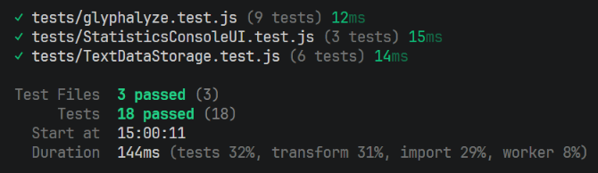

# Test Report

<!--
    Commit this file to the root of your GitHub repository, alongside your module's code.
    It is required regardless of how you tested your module — even if your tests live in a
    test application or use a testing framework, summarize them here.
-->

## Summary

*Briefly describe how you tested your module, and why you chose that approach — clearly enough
that someone else could carry out the same tests. What was hardest to test, and why?*

*If you used a testing framework, you may link to its generated report or include screenshots of
the test run here.*

Answer:
To test the application manual tests were used in combination with automatic unit tests. The manual tests follow the use cases to ensure that expected behavior is functional. The application was also tested gradually as new features was added the the console flow.

To manually test the application open the use cases and follow each scenario flow. Account for any potential preconditions that may be required.

Manual tests where used to test the main application flow while the automatic unit tests tests core components in more detail as well as some UI flows to further confirm that 3rd-party modules still work after potential updates.
The automatic test can be executed by running `npm run test`/`npm test` the root directory of the application after installing all dependencies.

The reason that most UI is tested manually is that the tests are dependant on the visual style of the output/options to determine if the result is correct. This was used on the statistics UI only because it is directly linked to the 3rd-party module. 
During development testing was done manually as features got implemented, this is done because output format is not final and unit tests would have to be updated multiple times while the manual tests can quickly confirm a vague placeholder output.

## Test Results

<!-- **Example** (shows what a filled-in row can look like — remove this example table before
submitting):

| What was tested                                                        | How it was tested                                                                                                       | Result                                                                       |
| ------------------------------------------------------------------------ | --------------------------------------------------------------------------------------------------------------------- | ------------------------------------------------------------------------------ |
| `Jpeg.load(path)` returns a `Picture` instance for a valid image file. | Automated unit test (Vitest): loaded `test-image.jpg` and checked that the return value had `getHeight()`/`getWidth()` methods. | ✅ Passed.                                                                    |
| `Picture.getPixelAt(x, y)` with coordinates outside the image.         | Manual test via the Test-App's interface: entered a coordinate pair larger than the image's width/height and observed the output. | ❌ Didn't throw an error initially — fixed, now throws a clear exception. | -->

**Your test results:**

| What was tested | How it was tested | Result |
| ---------------- | ------------------ | ------- |
| UC-01: Enter text manually | Manual test via console interface. Select option to load text line by line add enter a text. Enter a blank line and observe the result. | ✅ Passed. |
| UC-02: Load a saved text | **Manual test via console interface.** Select option to load saved text, if any exits select it and continue. Observe output. **Automated unit test (Vitest):** Tests the `TextDataStorage` class against pre-saved files. | ✅ Passed. |
| UC-03: View text statistics | **Manual test via console interface:** Start application, load text and select the text statistics option. go through each option and observe the output. **Automated unit test (Vitest):** Tests the statistics module directly and also runs through the StatisticsUI flow and validates the output. | ✅ Passed. |
| UC-04: Save the current text | **Manual test via console interface:** Manually load text from input and select the save option the in main menu. Save the text and close the restart the application, load the saved file and observe if it exits.   **Automated unit test (Vitest):** Tests the TextDataStorage class by saving files in a temporary directory. | ✅ Passed. |
| UC-05: Exit the application | **Manual test via console interface:** Select the exit option in the start menu and observe the application closing | ✅ Passed. |